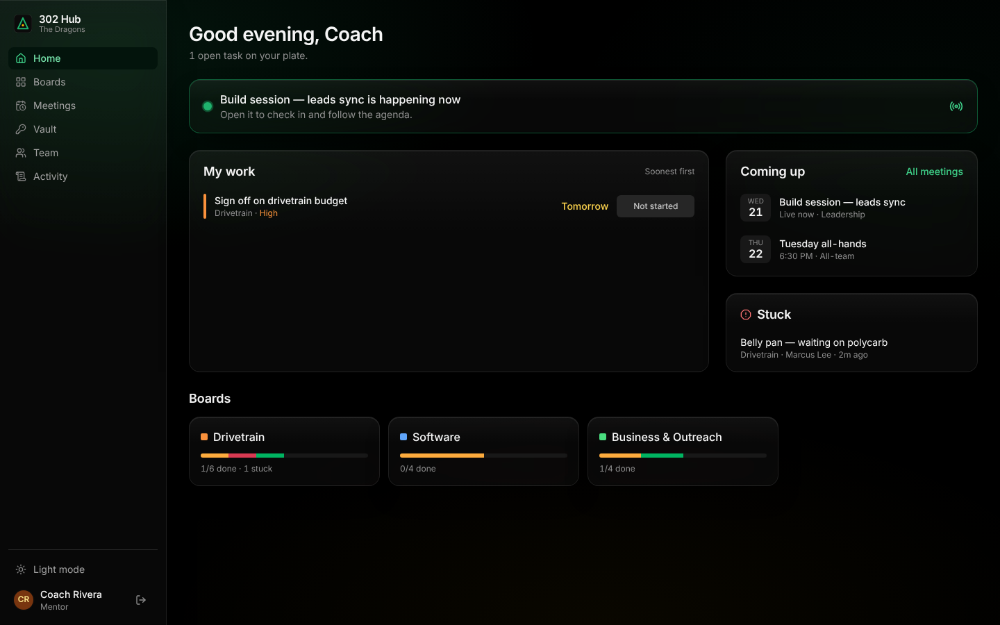
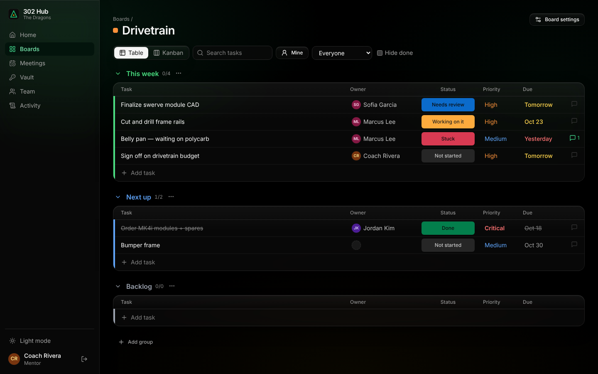
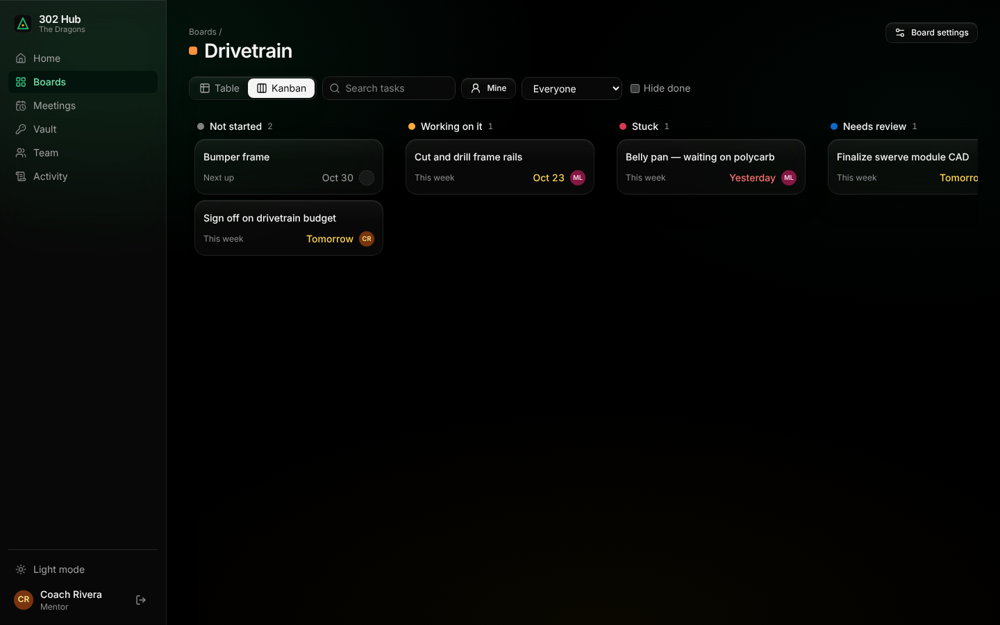
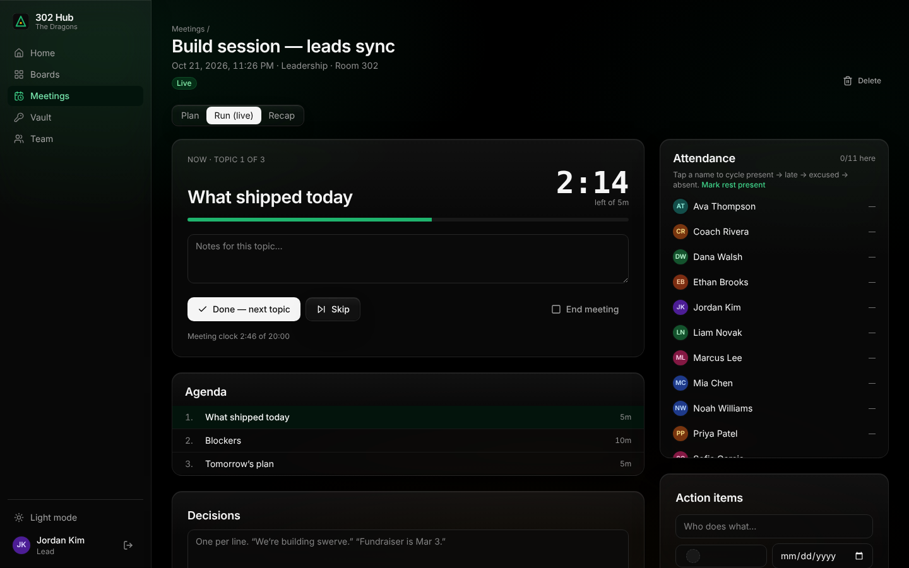
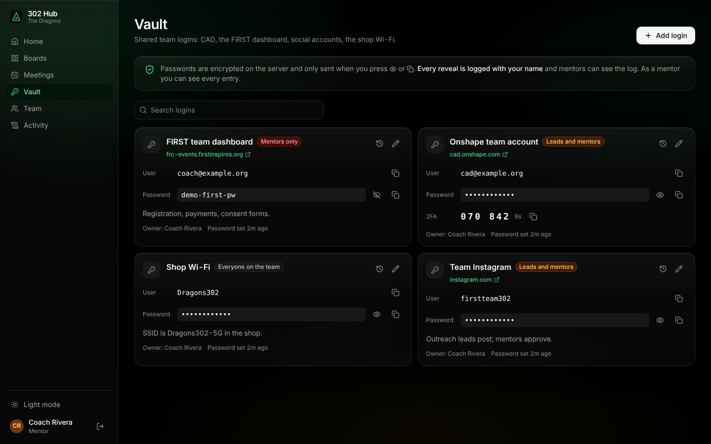

# 302 Hub

Task boards, meetings and a shared credential vault for **FRC Team 302, The Dragons**.
Monday.com-style boards, without Monday's learning curve. It uses ProjectPro's stack (Cloudflare Workers + D1 + React/Tailwind)
and its design system (ink buttons, glass surfaces, dark by default), with a 302 green accent.



| Boards (table) | Boards (kanban) |
|---|---|
|  |  |
| **Meeting: run mode** | **Vault** |
|  |  |

## What it does

**Boards.** One per subteam or project. Each board has groups (This week / Next up / Backlog) and tasks. Every task has an
owner, a status (Not started, Working on it, Stuck, Needs review, Done), a priority and a due date, all editable inline.
There's a table view and a drag-and-drop kanban, a "Mine" filter, a person filter and search. Each task opens a side panel
with a description and an updates thread.

**Meetings.** *Plan:* an agenda where every topic has a timebox and an owner, with a warning when the agenda runs longer
than the meeting. You can copy last week's agenda. *Run:* one topic at a time with a big countdown that turns red on
overtime, notes per topic, one-tap attendance, a decisions box, and action items. An action item is created as a real
task on a board, with an owner and a due date. Members can check themselves in from their phone. *Recap:* a Markdown
summary (attendance, agenda notes, decisions, action items) to paste into Slack, Discord or email, or to print.

**Vault.** Shared team logins: Onshape, the FIRST dashboard, social accounts, the shop Wi-Fi. Each entry is visible to
*everyone*, *leads and mentors*, or *mentors only*. Passwords are shown one at a time, auto-hide after 20 seconds, and are
cleared from the clipboard after 30 seconds. **Every reveal is logged with name, time and IP.** The vault can also hold a
**2FA authenticator key**, so the team account doesn't live on one mentor's phone. The server returns the 6-digit code,
never the key.

**Home.** Your open tasks (soonest first), the meeting happening now, upcoming meetings, stuck tasks across the team, and
progress for each board.

## Roles

| | Member | Lead | Mentor (admin) |
|---|---|---|---|
| See all boards; create, edit and finish tasks | ✓ | ✓ | ✓ |
| Delete a task | own only | ✓ | ✓ |
| Create, rename and archive boards and groups | | ✓ | ✓ |
| Delete a board | | | ✓ |
| See leadership meetings | | ✓ | ✓ |
| See mentor meetings | | | ✓ |
| Schedule and run meetings | facilitator only | ✓ | ✓ |
| Self check-in to a live meeting | ✓ | ✓ | ✓ |
| Vault: see and reveal entries shared with "everyone" | ✓ | ✓ | ✓ |
| Vault: entries shared with "leads and mentors" | | ✓ | ✓ |
| Vault: add entries; edit their own | | ✓ | ✓ |
| Vault: mentor-only entries, delete, access logs | | | ✓ |
| Add or remove people, change roles, subteams | | | ✓ |
| Activity log | | | ✓ |
| See teammates' email addresses | own only | ✓ | ✓ |

Roles are re-read from the database on **every request**, so removing someone or demoting them takes effect on their next click.

## Security model, stated plainly

### The vault
- Secrets are encrypted with AES-256-GCM using a key held as a Worker secret (`VAULT_KEY`). Each ciphertext is bound to its
  entry and field, so a blob copied to another row fails to decrypt (tested).
- **What this protects against:** a leaked D1 export or backup, or someone with read-only database access.
- **What it does NOT protect against:** anyone who controls the Cloudflare account or can deploy code. The Worker holds the
  key and decrypts on request. This is **not** end-to-end or zero-knowledge encryption the way 1Password or Bitwarden are.
  I chose that trade-off deliberately: no master password for students to forget, and the access log is enforced by the
  server. If your threat model includes a compromised Cloudflare account, use Bitwarden or 1Password Teams for the
  highest-value logins (bank, FIRST registration) and keep this for day-to-day logins.
- Reveals are limited to 30 per person per hour. The limiter is approximate under concurrent requests, so it bounds
  scraping but is not an exact quota.
- The access log records that someone *revealed* a secret. It cannot know what they did with it afterwards. **When someone
  leaves the team, rotate what they revealed.** The access log on each entry shows exactly what that was.
- Key rotation: set `VAULT_KEY_PREVIOUS` to the old key and `VAULT_KEY` to the new one, then call `POST /api/vault/rekey`
  as a mentor. Once it reports 0 failed, delete `VAULT_KEY_PREVIOUS`.

### Sign-in
- Production uses **Clerk**. The session token is verified inside the Worker: RS256 is pinned, the issuer is derived from the
  publishable key, the token must have been minted on this app's own origin (`azp`), and pending sessions are refused.
  This is the same check ProjectPro uses.
- A valid Clerk login proves an email address and nothing more. **Only people a mentor has added in Team can get in.** Anyone
  else gets a 401. The first mentor gets in through `BOOTSTRAP_ADMIN_EMAIL`, which only works while the team has no admin.
- The email has to be *verified* (`email_verified` in the token), because the email is what links a login to a person.
- A local dev sign-in exists. It refuses to run unless `ENVIRONMENT=development` **and** `DEV_LOGIN=on` **and** Clerk is not
  configured **and** the request is to localhost. All four conditions are tested.

### Minors
Most users are under 18, so the app stores **name and email only**: no phone numbers, birthdays, photos or addresses.
Members can't see other people's emails. If your district has a data-privacy agreement process, run this through it.

### Other limits you should know about
- **Self check-in trusts the device.** It proves someone had the app open while the meeting was live, not that they were in
  the room. Whoever runs the meeting can correct any entry.
- **There are no notifications yet.** No email or push when you're assigned a task or a meeting starts.
- **No real-time sync.** Two people editing the same board see each other's changes on refresh. Live meetings poll every
  10 seconds for people following along.
- **Brand colours and logo are placeholders.** The accent is a green and gold I picked, and the mark is a simple placeholder.
  Swap in the team's official colours in `frontend/tailwind.config.js` (`ACCENT`, `GOLD`) and the official logo in
  `frontend/src/components/BrandMark.jsx` and `frontend/public/favicon.svg`.

## Local development

Requires Node 22.13+.

```bash
npm install && npm install --prefix frontend
cp .dev.vars.example .dev.vars
# fill in JWT_SECRET (32+ random chars) and VAULT_KEY:
node -e "console.log(require('crypto').randomBytes(32).toString('base64'))"
npm run db:migrate:local
npm run dev                         # worker on :8787, app on http://localhost:5173
node scripts/seed-demo.mjs          # optional: a fake demo team, boards, meetings and vault entries
npm test                            # 25 integration tests, real SQLite, no mocks of app code
```

## Deploying to Cloudflare

1. `npx wrangler d1 create frc302-hub-db` and paste the id into `wrangler.toml`.
2. Set `APP_URL` in `wrangler.toml` to the URL the team will use, e.g. `https://hub.team302.org`.
3. **Clerk:** create an application.
   - Restrictions → Sign-up mode → **Restricted**. Nobody signs themselves up.
   - Sessions → Customize session token → add
     `{"email": "{{user.primary_email_address}}", "email_verified": "{{user.email_verified}}", "name": "{{user.full_name}}"}`.
   - Add your Clerk frontend host (`clerk.<your domain>`) to `script-src` and `connect-src` in `frontend/public/_headers`.
4. Secrets:
   ```bash
   npx wrangler secret put CLERK_PUBLISHABLE_KEY
   npx wrangler secret put CLERK_JWT_KEY          # Clerk → API keys → JWT public key (PEM)
   npx wrangler secret put BOOTSTRAP_ADMIN_EMAIL  # the head mentor
   npx wrangler secret put VAULT_KEY              # base64 of 32 random bytes; back it up offline
   ```
   **Back up `VAULT_KEY` somewhere outside Cloudflare.** If it's lost, every stored password is unrecoverable.
5. `npm run deploy` runs the tests, builds the app, migrates D1 and deploys.
6. Sign in as the bootstrap mentor, then add everyone in **Team**. Each person signs in with Clerk using the email you entered.

## Why a new app instead of forking ProjectPro

ProjectPro is about 116k lines of field-service business software: invoicing, Stripe Connect, payroll, QuickBooks, a client
portal and SMS. A robotics team would use maybe 5% of it, and would still inherit all of its complexity, attack surface and
migrations. This repo keeps what carried over well:

- the Cloudflare Worker + D1 + Workers Assets deployment
- the networkless Clerk verification
- the AES-GCM field encryption, extended with key ids for rotation
- the Tailwind design tokens and component styles

Everything else is purpose-built. The result is about 4k lines that a student programmer can read end to end.

## Layout

```
migrations/0001_init.sql      schema (users, subteams, boards, groups, items, updates, meetings, agenda, attendance, vault, activity)
worker/src/index.js           router, error handling, security headers
worker/src/lib/               auth (Clerk + dev), vault crypto, TOTP, validation, audit + rate limit
worker/src/routes/            team, boards, meetings, vault, home, auth
worker/test/                  integration tests (node:test + node:sqlite D1 shim)
frontend/src/pages/           Home, Boards, Board, Meetings, Meeting, Vault, Team, Activity
frontend/src/components/      Shell, ui primitives, ItemDrawer, BrandMark
scripts/seed-demo.mjs         demo data for local dev only
```
