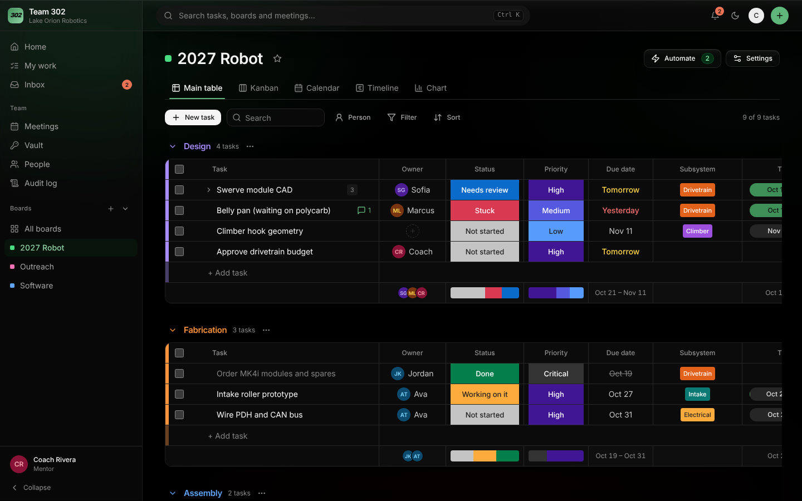
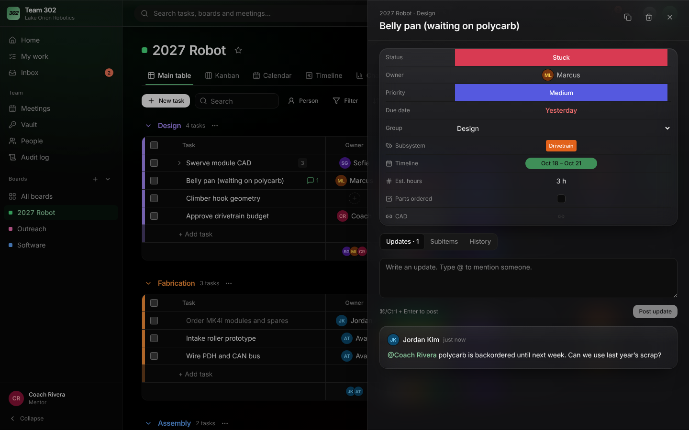
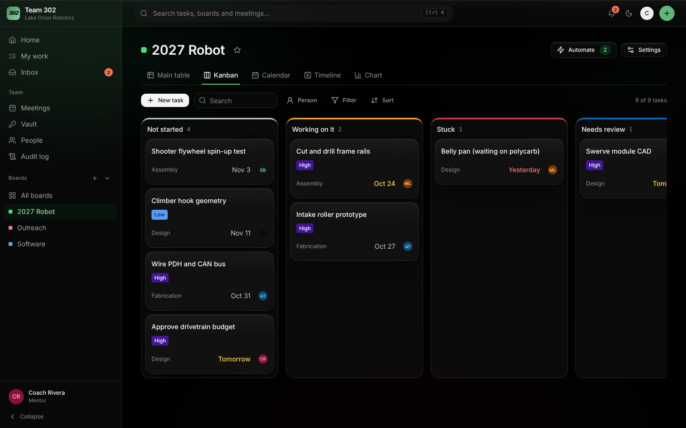
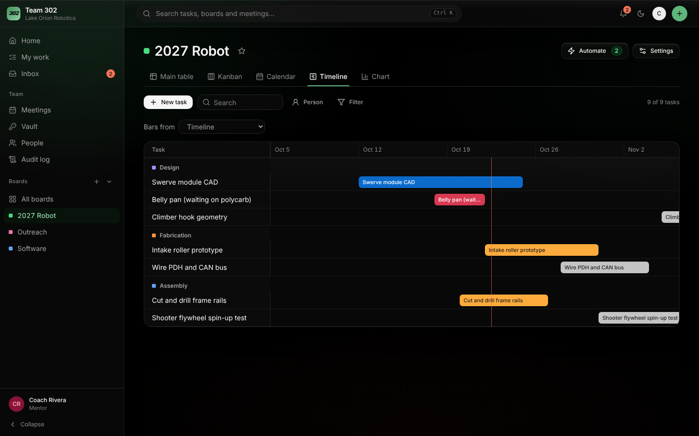
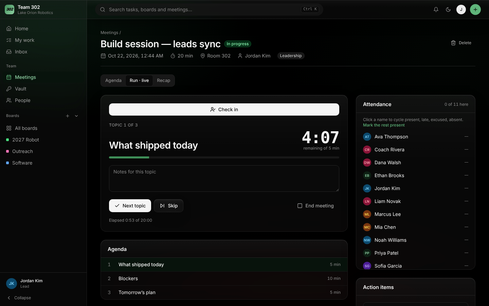
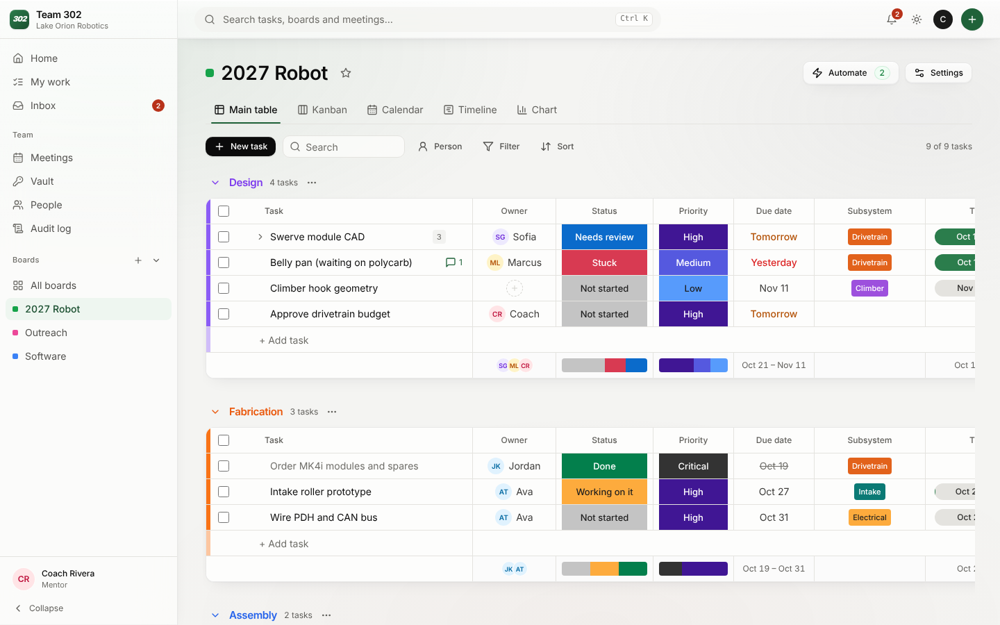

# 302 Hub

Task boards, meetings and a shared credential vault for **FRC Team 302, Lake Orion Robotics (The Dragons)**.
Boards work like Monday.com. The app is built on ProjectPro's stack (Cloudflare Workers + D1 + React/Tailwind) and its
component library (app shell, top bar, modals, toasts, stat cards, charts), in the team's dragon green and flame red.



| Home | Task panel |
|---|---|
|  |  |
| **Kanban** | **Timeline** |
|  |  |
| **Meeting, live** | **Light theme** |
|  |  |

## What it does

**Boards.** One per subteam or project, started from a template: Robot build (Design → Fabrication → Assembly → Testing,
with Subsystem, Timeline, Est. hours, Parts ordered and CAD columns), Parts & purchasing (Requested → Approved →
Ordered → Received, with vendor, link, quantity, cost totals per group and tracking), Competition prep, Outreach, or blank.
- **Columns you define:** status labels, people (several per task), date, timeline, text, numbers, checkbox, tags, link.
  Every board also has Owner, Status, Priority and Due date. The statuses can be renamed per board, and Owner, Priority
  and Due date can be hidden.
- **Groups** with a summary row under each: status mix, date range, number totals, checkbox counts, who's involved.
- **Subitems** under any task, with the same columns.
- **Drag and drop** to reorder tasks or move them between groups. Bulk-select to change status or owner, move,
  duplicate or delete.
- **Search, person filter, filters** (status, priority, overdue, due this week, no date) and **sort** by any column.
- **Views:** Main table, Kanban (lanes by status or any status column), Calendar (drag to reschedule), Timeline/Gantt,
  and Chart (status mix, open tasks per person and per group).
- **Task panel:** every field, an updates thread with **@mentions**, subitems, **files** (part photos, PDFs, CAD
  exports; drag and drop, up to 15 MB each, stored in Cloudflare R2), and a full **history** of who changed what.
- **Automations:** "when status changes to Done, move it to Testing", "when Stuck, notify a mentor", "when a task is
  created, assign it to …". Loops are capped.
- **Favorites** pin boards to the top of the sidebar.
- **Trash with Undo.** Deleting a task (or a bulk selection) shows an Undo; deleted tasks wait in the board's Trash for
  30 days with their subitems, values, updates and files, then the hourly job removes them for good. A lead, the task's
  creator, or whoever deleted it can restore it. Deleting a group or a board is still immediate.

**Inbox.** Notifications when you're assigned, added to a people column, @mentioned, when someone updates or changes the
status of a task you own, automation alerts, and due-date reminders (hourly job, once per task per day). The unread count
shows in the sidebar and on the top-bar bell.

**Install it like an app.** Add 302 Hub to a phone's Home Screen or install it from Chrome/Edge. Turn on
**push notifications** per device (Inbox → Turn on). Messages are encrypted end to end to the device (RFC 8291), so
Google/Apple/Mozilla's push services can't read them.

**Calendar feed.** Account menu → Calendar feed gives a private link for Google Calendar, Apple Calendar or Outlook:
team meetings you can see and your tasks with due dates.

**Attendance and hours** (leads and mentors). Hours and attendance rate per person from meetings run in the app,
for lettering, travel eligibility and grant reports. Filter by date range and subteam; export to CSV. Everyone sees
their own hours on Home.

**Season.** Kickoff, competitions, deadlines and outreach days with a countdown on everyone's Home; they're in the
calendar feed too.

**Workload** (leads and mentors). Open, overdue, due-this-week and stuck tasks per person across every board, with
who has nothing assigned.

**On phones,** boards show as cards (tap the status to change it) with a switch to the full table.

**Keyboard shortcuts:** `c` new task, `/` search, `g` then `h`/`w`/`i`/`b`/`m`/`s`/`v`/`p` to jump, `?` for the list.

**Recurring meetings.** Schedule a weekly series (up to 52) with the same agenda; delete the rest of a series in one go.

**My work.** Every open task and subitem you own across all boards, grouped into Overdue, Today, Next 7 days and later.

**Search (⌘K / Ctrl K).** Tasks, boards and meetings you can see.

**Meetings.** *Agenda:* topics with an owner and a time limit; it warns when the agenda runs longer than the meeting, and you
can copy last week's. *Run:* one topic at a time with a countdown that turns red on overtime, notes per topic, one-click
attendance, decisions, and action items that are created as real tasks on a board. Members check themselves in.
*Recap:* a Markdown summary to paste into Slack, Discord or email, or print.

**Vault.** Shared team logins (Onshape, the FIRST dashboard, social accounts, shop Wi-Fi). Each entry is visible to
everyone, leads and mentors, or mentors only. Passwords are revealed one at a time, hide after 20 seconds, and are cleared
from the clipboard after 30. **Every reveal is logged with name, time and IP.** An entry can hold a 2FA key: the server
hands out the 6-digit code, never the key. A generator makes strong passwords, and new passwords are checked against
known data breaches (Have I Been Pwned, k-anonymity: only 5 characters of the password's hash leave the browser).

**Setup checklist.** Mentors get a short checklist on Home (add people, first board, meetings, events, vault,
notifications) that ticks itself off.

## Roles

| | Member | Lead | Mentor (admin) |
|---|---|---|---|
| See all boards; create, edit and finish tasks | ✓ | ✓ | ✓ |
| Delete a task | own only | ✓ | ✓ |
| Add subitems, post updates, @mention | ✓ | ✓ | ✓ |
| Create boards; manage groups, columns, labels, automations; archive | | ✓ | ✓ |
| Delete a board | | | ✓ |
| See leadership meetings | | ✓ | ✓ |
| See mentor meetings | | | ✓ |
| Schedule and run meetings | facilitator only | ✓ | ✓ |
| Self check-in to a live meeting | ✓ | ✓ | ✓ |
| Vault: see and reveal entries shared with "everyone" | ✓ | ✓ | ✓ |
| Vault: entries shared with "leads and mentors" | | ✓ | ✓ |
| Vault: add entries; edit their own | | ✓ | ✓ |
| Vault: mentor-only entries, delete, access logs | | | ✓ |
| Add or remove people, change roles, subteams | | | ✓ |
| Activity log | | | ✓ |
| See teammates' email addresses | own only | ✓ | ✓ |

Roles are re-read from the database on **every request**, so removing someone or demoting them takes effect on their next click.

## Security model, stated plainly

### The vault
- Secrets are encrypted with AES-256-GCM using a key held as a Worker secret (`VAULT_KEY`). Each ciphertext is bound to its
  entry and field, so a blob copied to another row fails to decrypt (tested).
- **What this protects against:** a leaked D1 export or backup, or someone with read-only database access.
- **What it does NOT protect against:** anyone who controls the Cloudflare account or can deploy code. The Worker holds the
  key and decrypts on request. This is **not** end-to-end or zero-knowledge encryption the way 1Password or Bitwarden are.
  I chose that trade-off deliberately: no master password for students to forget, and the access log is enforced by the
  server. If your threat model includes a compromised Cloudflare account, use Bitwarden or 1Password Teams for the
  highest-value logins (bank, FIRST registration) and keep this for day-to-day logins.
- Reveals are limited to 30 per person per hour. The limiter is approximate under concurrent requests, so it bounds
  scraping but is not an exact quota.
- The access log records that someone *revealed* a secret. It cannot know what they did with it afterwards. **When someone
  leaves the team, rotate what they revealed.** The access log on each entry shows exactly what that was.
- Key rotation: set `VAULT_KEY_PREVIOUS` to the old key and `VAULT_KEY` to the new one, then call `POST /api/vault/rekey`
  as a mentor. Once it reports 0 failed, delete `VAULT_KEY_PREVIOUS`.

### Sign-in
- Production uses **Clerk**. The session token is verified inside the Worker: RS256 is pinned, the issuer is derived from the
  publishable key, the token must have been minted on this app's own origin (`azp`), and pending sessions are refused.
  This is the same check ProjectPro uses.
- A valid Clerk login proves an email address and nothing more. **Only people a mentor has added in Team can get in.** Anyone
  else gets a 401. The first mentor gets in through `BOOTSTRAP_ADMIN_EMAIL`, which only works while the team has no admin.
- The email has to be *verified* (`email_verified` in the token), because the email is what links a login to a person.
- A local dev sign-in exists. It refuses to run unless `ENVIRONMENT=development` **and** `DEV_LOGIN=on` **and** Clerk is not
  configured **and** the request is to localhost. All four conditions are tested.

### Minors
Most users are under 18, so the app stores **name and email only**: no phone numbers, birthdays, photos or addresses.
Members can't see other people's emails. If your district has a data-privacy agreement process, run this through it.

### Other limits you should know about
- **Self check-in trusts the device.** It proves someone had the app open while the meeting was live, not that they were in
  the room. Whoever runs the meeting can correct any entry.
- **Push notifications** reach phones and computers where someone turned them on (Inbox → Turn on). On iPhone/iPad
  that only works after adding the app to the Home Screen (iOS 16.4+). There is no email yet.
- **Near-real-time, not real-time.** Boards refresh every 20 seconds while open, and a live meeting every 10 seconds for
  people following along. Two people editing the same cell at once: the last save wins.
- **One owner per task.** The built-in Owner is single on purpose (one person accountable); add a People column for
  helpers. Subitems are one level deep.
- **Logo.** Put the team logo at `frontend/public/brand/logo.svg` (or `logo.png`, transparent background). The sign-in page
  shows it; small spots use the "302" mark. The brand colours are in `frontend/tailwind.config.js` (`ACCENT`, `FLAME`).

## Local development

Requires Node 22.13+.

```bash
npm install && npm install --prefix frontend
npm run db:migrate:local
npm run dev                         # worker on :8787, app on http://localhost:5173
node scripts/seed-demo.mjs          # optional, in a second terminal: fake team, boards, meetings, vault
npm test                            # integration tests, real SQLite, no mocks of app code
```

`npm run dev` first runs `scripts/setup-dev.mjs`. That creates `.dev.vars` with random secrets (a placeholder
`JWT_SECRET` or empty `VAULT_KEY` copied from the example gets filled in), and creates `frontend/dist`, which
`wrangler dev` needs before its first build. The first mentor is `mentor@example.org`; to use another address, set
`BOOTSTRAP_ADMIN_EMAIL` in `.dev.vars` before seeding.

**Using it from other devices (phones, the shop laptop):** `npm run dev:lan` serves the app on your network and prints
its address. Dev sign-in has no passwords, so this lets **anyone on that network sign in as anyone, mentors included**.
Use it with demo data only. Plain `npm run dev` refuses other devices. For real use, deploy (below).

`npm audit` in `frontend/` reports Tailwind 3's build tooling (braces, micromatch, chokidar). It runs only at
build time on your machine and none of it ships to the browser. The fix is a Tailwind 4 migration. Don't run
`npm audit fix --force`: it applies that migration blindly and breaks the styles.

## Deploying to Cloudflare

1. `npx wrangler d1 create frc302-hub-db` and paste the id into `wrangler.toml`. Then
   `npx wrangler r2 bucket create frc302-hub-files` for task attachments.
2. Set `APP_URL` in `wrangler.toml` to the URL the team will use, e.g. `https://hub.team302.org`.
3. **Clerk:** create an application.
   - Restrictions → Sign-up mode → **Restricted**. Nobody signs themselves up.
   - Sessions → Customize session token → add
     `{"email": "{{user.primary_email_address}}", "email_verified": "{{user.email_verified}}", "name": "{{user.full_name}}"}`.
   - Add your Clerk frontend host (`clerk.<your domain>`) to `script-src` and `connect-src` in `frontend/public/_headers`.
4. Secrets:
   ```bash
   npx wrangler secret put CLERK_PUBLISHABLE_KEY
   npx wrangler secret put CLERK_JWT_KEY          # Clerk → API keys → JWT public key (PEM)
   npx wrangler secret put BOOTSTRAP_ADMIN_EMAIL  # the head mentor
   npx wrangler secret put VAULT_KEY              # base64 of 32 random bytes; back it up offline
   npm run vapid                                  # prints a Web Push key pair, then:
   npx wrangler secret put VAPID_PUBLIC_KEY
   npx wrangler secret put VAPID_PRIVATE_KEY
   npx wrangler secret put VAPID_SUBJECT          # mailto:you@team302.org (push services' contact)
   ```
   **Back up `VAULT_KEY` somewhere outside Cloudflare.** If it's lost, every stored password is unrecoverable.
5. `npm run deploy` runs the tests, builds the app, migrates D1 and deploys.
6. Sign in as the bootstrap mentor, then add everyone in **Team**. Each person signs in with Clerk using the email you entered.

## Why a new app instead of forking ProjectPro

ProjectPro is about 116k lines of field-service business software: invoicing, Stripe Connect, payroll, QuickBooks, a client
portal and SMS. A robotics team would use maybe 5% of it, and would still inherit all of its complexity, attack surface and
migrations. This repo keeps what carried over well:

- the Cloudflare Worker + D1 + Workers Assets deployment
- the networkless Clerk verification
- the AES-GCM field encryption, extended with key ids for rotation
- the Tailwind design tokens and component styles

Everything else is purpose-built. The result is a codebase a student programmer can read end to end.

## Layout

```
migrations/                     0001 core schema; 0002 columns, values, subitems, history, notifications, automations
worker/src/index.js             router, error handling, security headers, hourly due-date reminders
worker/src/lib/items.js         every task change goes through here: history, notifications, automations
worker/src/lib/                 auth (Clerk + dev), column validation, vault crypto, TOTP, audit + rate limit
worker/src/routes/              boards, items, meetings, vault, team, home, auth
worker/test/                    integration tests (node:test + a node:sqlite D1 shim)
frontend/src/components/board/  the board: table, cells, columns, views, task panel, controls, useBoard
frontend/src/components/ui/     ProjectPro's component library (modals, stat cards, charts, avatars, …)
frontend/src/components/layout/ app shell, sidebar, top bar
frontend/src/pages/             Home, My work, Inbox, Boards, Board, Meetings, Meeting, Vault, People, Audit log
scripts/seed-demo.mjs           demo data for local dev only
```
